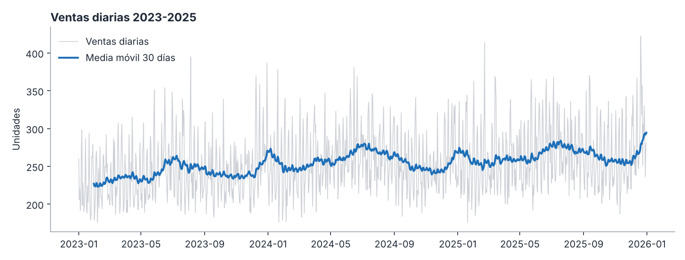
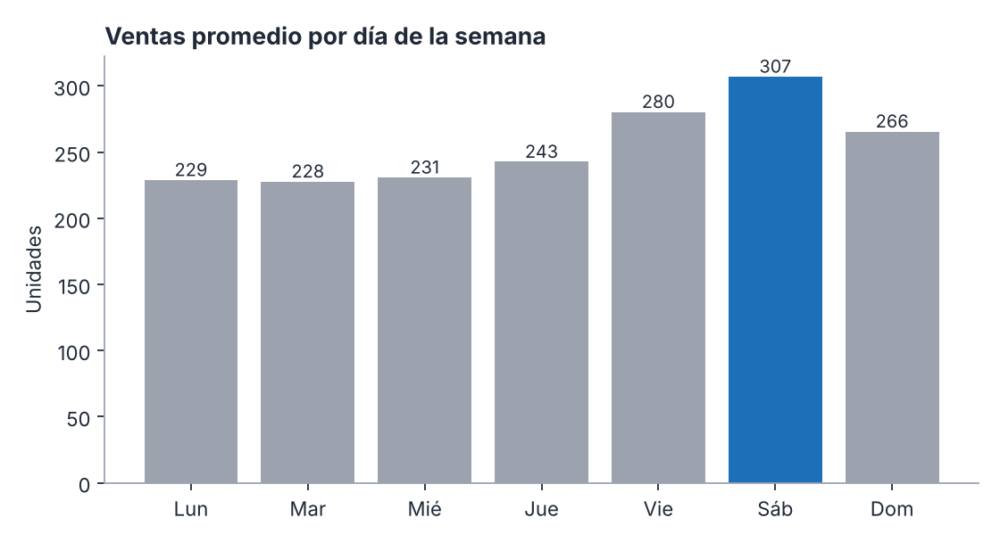
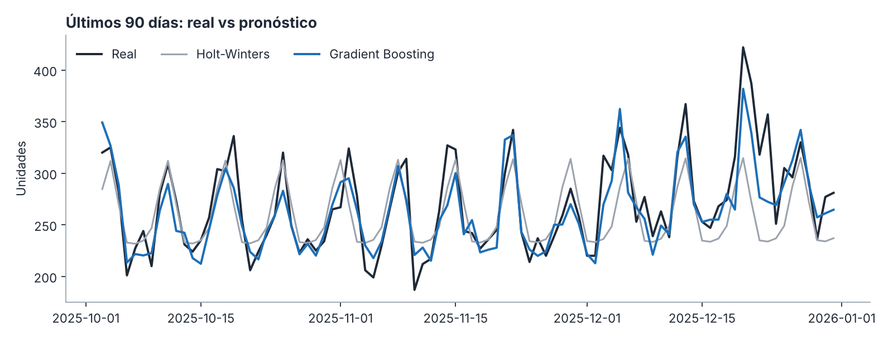
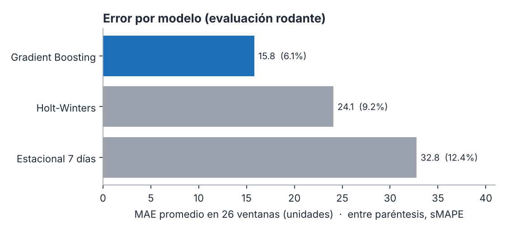
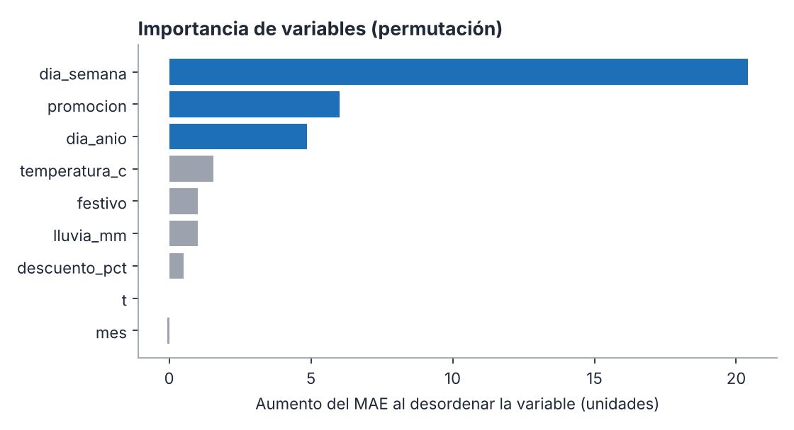

# Pronóstico de demanda multi-horizonte

Proyecto de series de tiempo: predecir las **ventas diarias** de una tienda combinando el patrón histórico (tendencia y estacionalidad) con **variables externas** (promociones, festivos y clima), y evaluar los modelos con **ventanas rodantes** en horizontes de hasta 28 días.

> Datos **sintéticos**, creados para practicar. El valor del proyecto está en el método, no en las cifras de una tienda real.

## Pregunta de negocio

¿Cuántas unidades se van a vender en los próximos días, y cuánto mejora el pronóstico si se incorporan promociones, festivos y clima en vez de mirar solo el historial de ventas?

## Datos

1.096 días (2023-01-01 a 2025-12-31) de una tienda en Cali: ventas, temperatura, lluvia, promoción, descuento, festivo y precio. Descripción de cada columna en [`data/diccionario_datos.md`](data/diccionario_datos.md).

## Qué se encontró en los datos



- **Tendencia creciente suave** (de ~225 a ~290 unidades en la media móvil de 30 días).
- **Estacionalidad anual:** las ventas suben hacia diciembre-enero y a mitad de año.
- **Estacionalidad semanal fuerte:** el sábado vende ~35 % más que el martes.



- Los días con promoción venden ~18 % más (292 vs 247 unidades).
- El calor se asocia con más ventas (correlación 0,22); la lluvia casi no (-0,08).

### Limpieza

| Problema | Decisión |
|---|---|
| 18 valores vacíos de temperatura | Interpolación entre el día anterior y el siguiente |
| 6 valores vacíos de lluvia | Se rellenan con 0 (la mayoría de los días no llueve; supuesto documentado) |
| 1 día con 0 ventas (sábado 2025-08-09) y 1 día con 1.012 ventas (2023-09-22) | Errores de registro: sin promoción, festivo ni otra causa visible. Se reemplazan por el promedio del mismo día de la semana anterior y siguiente |

## Modelos

| # | Modelo | Idea |
|---|---|---|
| 1 | Naive | Repetir el último valor |
| 2 | Estacional 7 días | Repetir la última semana |
| 3 | Holt-Winters | Nivel + tendencia + patrón semanal multiplicativo |
| 4 | Gradient Boosting | Calendario + promoción + festivo + clima, con tendencia removida y objetivo en escala logarítmica |

Métricas: **MAE** (unidades de error por día), **RMSE** (castiga más los errores grandes) y **sMAPE** (error porcentual).

### Primera comparación (últimos 90 días como prueba)

| Modelo | MAE | RMSE |
|---|---|---|
| Naive | 37,4 | 47,6 |
| Estacional 7 días | 30,5 | 42,4 |
| Holt-Winters | 25,5 | 35,2 |
| Gradient Boosting (calendario y promociones) | 19,6 | 26,4 |
| + clima | 17,7 | 24,5 |
| + logaritmo y tendencia removida | **16,8** | **23,0** |

El Gradient Boosting inicial se quedaba corto de forma sistemática (sesgo de +14 unidades por día) porque los árboles de decisión no extrapolan la tendencia. Quitar la tendencia con una recta y modelar el logaritmo de las ventas redujo ese sesgo a +8.



## Evaluación en ventanas rodantes

Para no ajustar el modelo a una sola ventana de prueba (que además era diciembre), se simularon **26 fechas de pronóstico**: en cada una se entrena solo con el pasado, se pronostican 28 días y se avanza 28 días.



| Modelo | MAE | sMAPE |
|---|---|---|
| Estacional 7 días | 32,8 | 12,4 % |
| Holt-Winters | 24,1 | 9,2 % |
| **Gradient Boosting** | **15,8** | **6,1 %** |

El error de Gradient Boosting reduce ~34 % el de Holt-Winters y ~52 % el del estacional.

**Por horizonte (en tramos de 7 días):**

| Tramo | Estacional | Holt-Winters | Gradient Boosting |
|---|---|---|---|
| 1-7 | 34,2 | 24,4 | 14,8 |
| 8-14 | 31,6 | 22,0 | 15,8 |
| 15-21 | 31,3 | 23,8 | 14,9 |
| 22-28 | 34,0 | 26,2 | 17,7 |

El error casi no crece con el horizonte, porque el modelo usa variables que se conocen de cada día futuro (calendario y promociones) y no depende de las ventas más recientes.

> **Nota metodológica:** al principio se miraba el error por día de horizonte (1, 7, 14, 28) y los resultados salían desordenados. La causa: con orígenes cada 28 días, cada horizonte caía siempre en el mismo día de la semana. Se resolvió agrupando por tramos de 7 días y usando sMAPE.

## ¿Qué variables importan?



Medido como cuánto sube el error al desordenar cada variable. El **día de la semana** es, por mucho, la más importante (el error se duplicaría sin ella), seguido de la **promoción** y la **época del año**; la temperatura aporta menos pero es útil, y la lluvia y el festivo aportan poco. `mes` y `t` quedan en cero porque su información ya está en `dia_anio` y en la tendencia removida.

## Limitaciones

- **El clima del futuro no se conoce.** En las pruebas se usó la temperatura y la lluvia reales, lo cual es optimista. Se probó el escenario realista:

  | Escenario | MAE | sMAPE |
  |---|---|---|
  | Clima real (optimista) | 15,80 | 6,06 % |
  | Clima promedio del mes | 16,92 | 6,46 % |
  | Sin clima | 17,65 | 6,76 % |

  Aun sin clima, el modelo supera a los demás: el error esperado en producción está entre 6,1 % y 6,8 %.
- Persiste un **sesgo positivo** (el modelo se queda algo corto en los picos, sobre todo en temporada alta de diciembre).
- Solo hay tres años de datos, por lo que cada época del año se ha visto pocas veces.
- No se ajustaron hiperparámetros ni se calcularon intervalos de predicción.

## Próximos pasos

- Variables de rezago de ventas (hace 7, 14 y 28 días) y un modelo distinto por horizonte.
- Intervalos de predicción (por ejemplo, regresión cuantílica).
- Revisar el efecto de los días posteriores a una promoción y posibles cambios de nivel.
- Una app en Streamlit para mover los parámetros y ver el pronóstico.

## Estructura

```
proyecto-pronostico-demanda/
├── README.md
├── data/
│   ├── ventas_diarias.csv
│   └── diccionario_datos.md
├── notebooks/
│   └── pronostico_demanda.ipynb
└── docs/img/
```

## Cómo reproducirlo

Abrir `notebooks/pronostico_demanda.ipynb` en Google Colab (botón "Open in Colab" al inicio del cuaderno), subir `data/ventas_diarias.csv` al panel de archivos y ejecutar las celdas en orden.

Librerías: `pandas`, `numpy`, `matplotlib`, `statsmodels`, `scikit-learn`.

## Herramientas

Python · pandas · statsmodels (Holt-Winters) · scikit-learn (Gradient Boosting) · matplotlib · Google Colab
